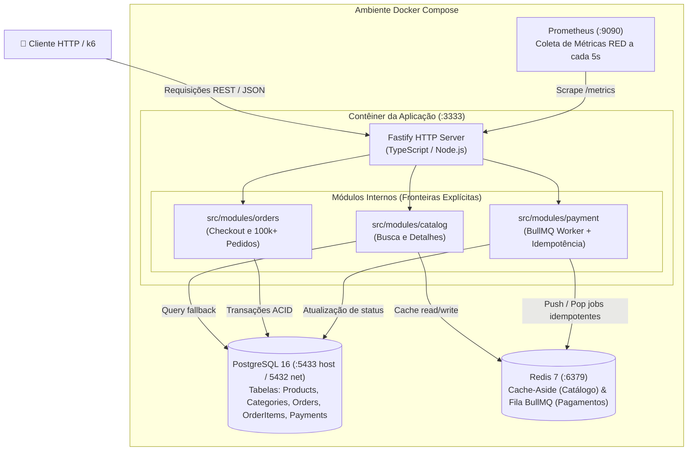

# Modelagem C4 — Marketplace Modular

Este documento descreve os diagramas de **Contexto do Sistema (Nível 1)** e **Contêineres (Nível 2)** do Modelo C4 para o Marketplace Modular.

---

## Nível 1: Diagrama de Contexto (System Context)

O diagrama de contexto apresenta os atores externos (Clientes e Operadores) e a fronteira do sistema com gateways externos.

```mermaid
graph TD
    User["👤 Cliente do Marketplace<br/>(Navegador / App Mobile)"]
    Admin["👤 Operador / Administrador<br/>(Gestão de Produtos e Estoque)"]
    Gateway["💳 Gateway de Pagamento Externo<br/>(Processador Pix / Cartão / Boleto)"]
    
    Marketplace["📦 Sistema Marketplace<br/>[Monólito Modular Fastify]<br/>Fornece catálogo, pedidos e orquestração de pagamento"]

    User -->|Consulta produtos, cria pedidos e consulta status [HTTPS]| Marketplace
    Admin -->|Cadastra e atualiza produtos do catálogo [HTTPS]| Marketplace
    Marketplace -->|Envia autorização e recebe webhooks de cobrança [HTTPS]| Gateway
```

---

## Nível 2: Diagrama de Contêineres (Container Diagram)

O diagrama de contêineres detalha as unidades de execução implantadas via Docker Compose.



---

## Resumo das Fronteiras e Responsabilidades

| Contêiner / Módulo | Tecnologia | Responsabilidade Principal |
| :--- | :--- | :--- |
| **Catalog Module** | TypeScript + Redis Cache-Aside | Consulta de produtos com sub-10ms no p95 para requisições em cache. |
| **Orders Module** | TypeScript + Prisma + PostgreSQL | Registro atômico de pedidos com volume sintético de 100.000 registros e paginação por cursor. |
| **Payment Module** | TypeScript + BullMQ + Strategy Pattern | Processamento desacoplado em background com proteção estrita contra duplicação de transação. |
| **PostgreSQL** | Relational Database (16-alpine) | Persistência confiável com constraints de integridade e índices otimizados. |
| **Redis** | In-Memory Data Store (7-alpine) | Cache distribuído com TTL e backend da fila de alta vazão. |
| **Prometheus** | Time-series Database | Monitoramento em tempo real das métricas RED (Taxa, Erro e Duração). |

